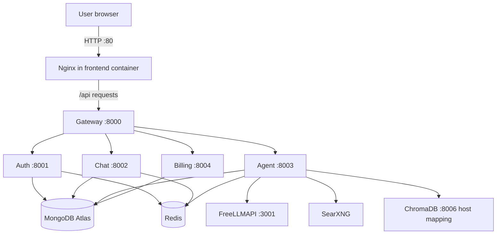

# NoBound AI — AWS EC2 Deployment Runbook

A practical reference for deploying, operating, updating, and troubleshooting the NoBound AI multi-service application on an Ubuntu EC2 instance.

> **Scope and accuracy:** This guide records the deployment setup and commands from the NoBound AI EC2 work captured in this conversation. Some values can change (especially the EC2 public IP, PEM filename, repository URL, and environment variables). Commands marked **optional / standard setup** are useful supporting commands; they are not a claim that each one was run during the original deployment.

---

## 1. Deployment overview

NoBound AI is deployed as multiple Docker services on one Ubuntu EC2 instance. Docker Compose starts the application services and supporting infrastructure together.



### Known services and ports

| Service | Purpose | Port / access noted in deployment |
|---|---|---|
| `frontend` | React/Vite app served by Nginx | Host port `80` → container port `80` |
| `gateway` | Public-facing API gateway / reverse proxy | Container port `8000`; frontend Nginx proxies `/api` to `gateway:8000` |
| `auth` | Authentication service | Container port `8001` |
| `chat` | Chat and conversation service | Container port `8002` |
| `agent` | AI agent / LangGraph workflows | Container port `8003` |
| `billing` | Credits and billing service | Container port `8004` |
| `freellmapi` | OpenAI-compatible model API | Host binding `127.0.0.1:3001` → container `3001` (local to EC2) |
| `redis` | Cache / queue / shared state | Internal Docker network |
| `chroma` | Vector database for RAG | Docker service; previously tested with host mapping `8006:8000` |
| `searxng` | Web search backend | Internal Docker network |

**Important networking rule:** FreeLLMAPI was deliberately bound to `127.0.0.1:3001`, not `0.0.0.0:3001`. Do not expose that provider dashboard/API port publicly unless you intentionally add authentication and a secure access design.

---

## 2. Project layout

The deployed project directory used in the EC2 notes was:

```text
/home/ubuntu/cortexAI/
├── docker-compose.yml          # Main deployment: app + supporting services
├── frontend/                   # React/Vite frontend and its Dockerfile/Nginx config
├── gateway/                    # Express API gateway + Dockerfile
├── backend/
│   ├── .env                    # Deployment environment values (secrets live here)
│   ├── auth/                   # Auth service + Dockerfile
│   ├── chat/                   # Chat service + Dockerfile
│   ├── agent/                  # Agent service + Dockerfile
│   └── billing/                # Billing service + Dockerfile
└── ...                         # Shared code/configuration as present in the repository
```

The repository has individual Dockerfiles for the application services. The root `docker-compose.yml` is what coordinates the complete stack. The deployment command used `backend/.env` as the Compose interpolation file.

> The exact contents and nesting of folders can evolve. Use the inspection commands below to see the live repository rather than assuming every optional file shown above exists.

### Inspect the actual structure on EC2

```bash
cd /home/ubuntu/cortexAI
pwd
ls -la
find . -maxdepth 3 -type f \
  -not -path './.git/*' \
  -not -path '*/node_modules/*' \
  | sort
```

Optional prettier tree view:

```bash
sudo apt update
sudo apt install -y tree
tree -L 3 -I 'node_modules|.git|dist|build'
```

---

## 3. AWS EC2 prerequisites and network access

### EC2 details recorded for this deployment

- Operating system: Ubuntu (the instance reported Ubuntu `26.04.1`).
- SSH user: `ubuntu`.
- Docker and Docker Compose were installed; the instance reported Docker `29.1.3` and Compose `2.40.3` in the deployment notes.
- Last recorded public IP: `16.178.153.181`.
- DuckDNS hostname: `nobound-ai.duckdns.org`.
- HTTP on port `80` was working through Nginx.
- HTTPS on port `443` was **not yet configured** at the last check; connecting to 443 returned connection refused.

The IP above is a historical value from the deployment session, not a permanent guarantee. Check the current EC2 Public IPv4 address in the AWS console before connecting. A stop/start can change the public IP unless an Elastic IP is associated.

### Security Group inbound rules

The recorded security-group configuration was:

| Type | Port | Source | Reason |
|---|---:|---|---|
| SSH | 22 | Your current public IP `/32` | Administrative SSH access only |
| HTTP | 80 | `0.0.0.0/0` | Public website traffic |
| HTTPS | 443 | `0.0.0.0/0` | Needed when TLS is configured |

Do **not** open internal microservice ports (`8000`–`8004`), Redis, Chroma, or FreeLLMAPI to the entire internet. The frontend Nginx container is the public entry point in this deployment.

### DuckDNS / DNS check

The hostname configured was `nobound-ai.duckdns.org`. Check that it resolves to the current EC2 public IP:

```bash
# Run on Windows PowerShell or on a machine with nslookup installed
nslookup nobound-ai.duckdns.org

# Alternative on Ubuntu (install dnsutils if dig is missing)
sudo apt update && sudo apt install -y dnsutils
dig +short nobound-ai.duckdns.org
```

If the EC2 public IP changes, update the DuckDNS record to the new address. Do not publish your DuckDNS update token in source control, screenshots, or support messages.

---

## 4. Connect from Windows to EC2

Run SSH commands in **Windows PowerShell on your own computer**, not inside the EC2 shell.

Set the path to your downloaded EC2 private key (`.pem`) and the current EC2 IP:

```powershell
$KEY = "$HOME\Downloads\YOUR-EC2-KEY.pem"
$EC2_IP = "16.178.153.181"
ssh -i $KEY ubuntu@$EC2_IP
```

Replace `YOUR-EC2-KEY.pem` with the real filename. The key path must exist on Windows. A common mistake from the earlier setup was trying to use a Windows path such as `C:\Users\...\Downloads\...pem` after already entering the Ubuntu SSH session. Windows paths only work in PowerShell on the Windows computer.

To leave the EC2 session:

```bash
exit
```

---

## 5. First-time EC2 checks and Docker verification

After SSH login:

```bash
whoami
hostname
pwd
lsb_release -a
uname -a
free -h
df -h
```

Verify the installed container tools:

```bash
sudo docker --version
sudo docker compose version
sudo docker ps
sudo docker compose ls
```

The `ubuntu` account initially encountered Docker socket permission errors. The reliable commands used during the deployment were therefore prefixed with `sudo`:

```bash
sudo docker ps
sudo docker compose ...
```

Do not assume Docker group membership is configured. Using `sudo` is safe and consistent with the commands used in this deployment.

### Optional: install Docker on a fresh Ubuntu EC2 instance

This is a standard fallback only if Docker is not already installed. Do not reinstall Docker on the working instance just for the sake of following this section.

```bash
sudo apt update
sudo apt install -y ca-certificates curl
sudo install -m 0755 -d /etc/apt/keyrings
sudo curl -fsSL https://download.docker.com/linux/ubuntu/gpg \
  -o /etc/apt/keyrings/docker.asc
sudo chmod a+r /etc/apt/keyrings/docker.asc

. /etc/os-release
 echo "deb [arch=$(dpkg --print-architecture) signed-by=/etc/apt/keyrings/docker.asc] https://download.docker.com/linux/ubuntu ${UBUNTU_CODENAME:-$VERSION_CODENAME} stable" \
  | sudo tee /etc/apt/sources.list.d/docker.list > /dev/null

sudo apt update
sudo apt install -y docker-ce docker-ce-cli containerd.io \
  docker-buildx-plugin docker-compose-plugin

sudo systemctl enable --now docker
sudo docker --version
sudo docker compose version
```

---

## 6. Get the project onto EC2

The project directory used in the deployment notes is `/home/ubuntu/cortexAI`.

### If the repository is already on EC2

```bash
cd /home/ubuntu/cortexAI
git status
git pull
```

### If setting up a new instance

Clone your own repository URL (replace the placeholder):

```bash
cd /home/ubuntu
git clone YOUR_GIT_REPOSITORY_URL cortexAI
cd /home/ubuntu/cortexAI
```

For a private repository, configure GitHub SSH access or another secure Git authentication method. Do not paste access tokens into shell history or commit them to the repository.

---

## 7. Configure environment variables

The deployment command uses this file:

```text
/home/ubuntu/cortexAI/backend/.env
```

Open it on the EC2 instance:

```bash
cd /home/ubuntu/cortexAI
nano backend/.env
```

Keep all API keys, database credentials, OAuth secrets, encryption keys, and payment secrets in the environment file or a secret manager. Never commit `.env` to Git.

### Compose interpolation variables explicitly used in this deployment

These names were identified in the root Compose configuration:

```text
FREELLMAPI_ENCRYPTION_KEY
VITE_FRIEBASE_API_KEY
VITE_RAZORPAY_KEY_ID
```

**Spelling note:** `VITE_FRIEBASE_API_KEY` is spelled exactly this way in the existing project configuration (the `B`/`A` spelling looks unusual). Preserve the name as it appears in both the Compose file and frontend build configuration unless you deliberately update every reference in the codebase.

Check that the values are set without printing the secret values:

```bash
cd /home/ubuntu/cortexAI
for v in FREELLMAPI_ENCRYPTION_KEY VITE_FRIEBASE_API_KEY VITE_RAZORPAY_KEY_ID; do
  if grep -qE "^${v}=.+" backend/.env; then
    echo "${v}: set"
  else
    echo "${v}: MISSING or empty"
  fi
done
```

You can inspect only variable names (not values) with:

```bash
cut -d= -f1 backend/.env | sed '/^[[:space:]]*$/d' | sort -u
```

### Important FreeLLMAPI encryption-key rule

The FreeLLMAPI SQLite database stores encrypted provider credentials. The `FREELLMAPI_ENCRYPTION_KEY` used by the running FreeLLMAPI service must remain the same key that was used to encrypt the restored database. The original key and restored database were verified to match during recovery. **Do not rotate or replace this key casually**, or saved provider credentials may no longer decrypt.

Do not run `cat backend/.env` and paste its output into chat, GitHub, or a public issue.

---

## 8. Understand the Compose command used for deployment

The main Compose file is at the repository root:

```text
/home/ubuntu/cortexAI/docker-compose.yml
```

The environment interpolation file is `backend/.env`. That is why the deployment commands include `--env-file backend/.env`.

First validate the Compose configuration:

```bash
cd /home/ubuntu/cortexAI
sudo docker compose --env-file backend/.env config --quiet
```

Inspect named volumes declared by the Compose configuration:

```bash
sudo docker compose --env-file backend/.env config --volumes
```

> `docker compose config` without `--quiet` can print resolved configuration, potentially including interpolated environment values. Do not share that output publicly without checking it for secrets.

### Build and start the complete application

This is the main deployment command used for the stack:

```bash
cd /home/ubuntu/cortexAI
sudo docker compose --env-file backend/.env up -d --build
```

What it does:

1. Reads the root `docker-compose.yml`.
2. Loads Compose interpolation values from `backend/.env`.
3. Builds images from the service Dockerfiles where required.
4. Creates or reuses the Compose network and named volumes.
5. Starts the frontend, gateway, auth, chat, agent, billing, Redis, Chroma, SearXNG, and FreeLLMAPI services in the background.

### Verify startup

```bash
sudo docker compose --env-file backend/.env ps
sudo docker ps
```

Follow all service logs:

```bash
sudo docker compose --env-file backend/.env logs -f
```

Exit the live log view with `Ctrl+C`. This stops log-following, not the containers.

Follow one service:

```bash
sudo docker compose --env-file backend/.env logs -f gateway
sudo docker compose --env-file backend/.env logs -f frontend
sudo docker compose --env-file backend/.env logs -f agent
sudo docker compose --env-file backend/.env logs -f freellmapi
```

Show the latest 100 lines without following:

```bash
sudo docker compose --env-file backend/.env logs --tail=100 gateway
```

---

## 9. Useful day-to-day Docker Compose commands

Always run these from the project root or supply the Compose file path explicitly.

```bash
cd /home/ubuntu/cortexAI
```

| Task | Command |
|---|---|
| Check service status | `sudo docker compose --env-file backend/.env ps` |
| Start services | `sudo docker compose --env-file backend/.env start` |
| Stop services (keep containers/volumes) | `sudo docker compose --env-file backend/.env stop` |
| Restart all services | `sudo docker compose --env-file backend/.env restart` |
| Restart one service | `sudo docker compose --env-file backend/.env restart gateway` |
| Rebuild and restart all | `sudo docker compose --env-file backend/.env up -d --build` |
| Rebuild one service and its dependencies | `sudo docker compose --env-file backend/.env up -d --build gateway` |
| View logs | `sudo docker compose --env-file backend/.env logs --tail=100` |
| Follow one service's logs | `sudo docker compose --env-file backend/.env logs -f agent` |
| List Compose services | `sudo docker compose --env-file backend/.env config --services` |
| See running containers | `sudo docker ps` |
| See all containers, including stopped | `sudo docker ps -a` |
| See local images | `sudo docker images` |
| See Docker disk usage | `sudo docker system df` |

### Deploy code updates

After pushing code changes to the repository:

```bash
cd /home/ubuntu/cortexAI
git pull
sudo docker compose --env-file backend/.env up -d --build
sudo docker compose --env-file backend/.env ps
```

If only a particular service changed, rebuild that service instead of rebuilding every image, for example:

```bash
sudo docker compose --env-file backend/.env up -d --build agent
```

### Stop the stack safely

```bash
sudo docker compose --env-file backend/.env stop
```

To remove the Compose containers and network while retaining named data volumes:

```bash
sudo docker compose --env-file backend/.env down
```

**Never use `docker compose down -v` as a routine cleanup command.** The `-v` option removes named volumes and can permanently delete databases and FreeLLMAPI provider-key data. It was especially important to preserve the recovered FreeLLMAPI volume in this deployment.

---

## 10. FreeLLMAPI: access, health check, and persistent data

FreeLLMAPI was running in Docker and bound on the EC2 host only at `127.0.0.1:3001`.

### Test its API from the EC2 instance

```bash
curl -i http://127.0.0.1:3001/api/ping
```

The deployment check returned HTTP `200`.

### Open the FreeLLMAPI dashboard securely from Windows

Use SSH port forwarding from Windows PowerShell:

```powershell
$KEY = "$HOME\Downloads\YOUR-EC2-KEY.pem"
$EC2_IP = "16.178.153.181"
ssh -i $KEY -L 3001:127.0.0.1:3001 ubuntu@$EC2_IP
```

Keep that SSH session open, then open this URL on the Windows computer:

```text
http://127.0.0.1:3001
```

The dashboard traffic is carried through SSH. Do not open EC2 inbound port `3001` to the public internet for this workflow.

### Check the FreeLLMAPI container and volume mount

```bash
sudo docker ps --filter name=freellmapi
sudo docker inspect cortexai-freellmapi-1 \
  --format '{{range .Mounts}}{{println .Name "->" .Destination}}{{end}}'
```

The recovered persistent volume in the deployment notes was:

```text
freellmapi_recovery_data -> /app/server/data
```

List Docker volumes:

```bash
sudo docker volume ls
```

Inspect the recovery volume:

```bash
sudo docker volume inspect freellmapi_recovery_data
```

### What was recovered

The original Windows FreeLLMAPI database (`freeapi.db`) was transferred to EC2 and verified by SHA-256 before activation. The database integrity check returned `ok`. The recovered database contained 11 API-key records, 481 models, 481 profile-model records, and one profile and user. The restored volume was named `freellmapi_recovery_data` and mounted at `/app/server/data`.

An EC2 pre-recovery backup was retained at:

```text
/home/ubuntu/freellmapi-backup/ec2-freellmapi-before-recovery.tar.gz
```

The Windows-side original backup was recorded at:

```text
D:\AI MERN PROJECT\cortexai\freeapi-original.db
```

Those paths are historical recovery references; keep your own backups in a secure location too.

### Make a fresh backup of the recovered FreeLLMAPI data volume

For a safer SQLite file-level archive, stop FreeLLMAPI briefly, archive the volume, then start it again. This causes a short FreeLLMAPI interruption:

```bash
cd /home/ubuntu/cortexAI
sudo mkdir -p /home/ubuntu/freellmapi-backup

sudo docker compose --env-file backend/.env stop freellmapi
sudo docker run --rm \
  -v freellmapi_recovery_data:/data:ro \
  -v /home/ubuntu/freellmapi-backup:/backup \
  alpine sh -c 'tar czf /backup/freellmapi-data-$(date +%F-%H%M%S).tar.gz -C /data .'
sudo docker compose --env-file backend/.env start freellmapi

ls -lh /home/ubuntu/freellmapi-backup
```

Check the archive listing:

```bash
sudo tar -tzf /home/ubuntu/freellmapi-backup/NAME-OF-BACKUP.tar.gz | head -40
```

Replace `NAME-OF-BACKUP.tar.gz` with the actual filename. Copy backups off the EC2 instance periodically; an archive stored only on the same EC2 disk is not disaster recovery.

**Do not delete, prune, rename, or replace `freellmapi_recovery_data` unless you have verified a separate backup and intentionally planned a migration.**

---

## 11. Frontend, domain, and HTTP checks

The frontend Nginx configuration proxies API paths to the gateway service using the Docker service name `gateway` and port `8000`. The frontend container publishes host port `80`.

### Check the local web server

```bash
curl -I http://127.0.0.1
```

### Check the public DuckDNS hostname

```bash
curl -I http://nobound-ai.duckdns.org
```

The recorded check returned HTTP `200` through Nginx.

### Check which processes are listening on web ports

```bash
sudo ss -tulpn | grep -E ':80|:443|:3001|:8000|:8001|:8002|:8003|:8004'
```

At the last recorded check, HTTP port `80` worked but HTTPS port `443` refused connections. The security group allowed port `443`, but opening a security-group rule alone does not enable HTTPS. A TLS certificate and Nginx TLS configuration still need to be installed and wired into the frontend container before `https://nobound-ai.duckdns.org` will work.

### Firebase configuration reminder

The hostname used for the public site was:

```text
nobound-ai.duckdns.org
```

It was added to Firebase Authentication's authorized domains. In Firebase Console, authorized domains contain the hostname only (not `https://` and not a path). Also verify any OAuth redirect configuration required by the Firebase login flow after changing the domain or protocol.

---

## 12. Health checks and troubleshooting commands

### Check all containers and resource usage

```bash
sudo docker ps
sudo docker stats
free -h
df -h
```

### Check whether a container exited or is restarting

```bash
sudo docker ps -a
sudo docker compose --env-file backend/.env ps
```

### Inspect a service's recent logs

```bash
sudo docker compose --env-file backend/.env logs --tail=200 auth
sudo docker compose --env-file backend/.env logs --tail=200 chat
sudo docker compose --env-file backend/.env logs --tail=200 agent
sudo docker compose --env-file backend/.env logs --tail=200 billing
sudo docker compose --env-file backend/.env logs --tail=200 gateway
sudo docker compose --env-file backend/.env logs --tail=200 frontend
```

### Check Docker daemon

```bash
sudo systemctl status docker --no-pager
sudo journalctl -u docker -n 100 --no-pager
```

### Check application port bindings

```bash
sudo docker port cortexai-frontend-1
sudo docker port cortexai-freellmapi-1
```

Container names recorded during the deployment included:

```text
cortexai-freellmapi-1
cortexai-auth-1
cortexai-frontend-1
cortexai-gateway-1
cortexai-chat-1
cortexai-agent-1
cortexai-billing-1
cortexai-redis-1
cortexai-chroma-1
cortexai-searxng-1
```

If the Compose project name or service names change, get the live names from `sudo docker ps` and `docker compose ps` rather than blindly copying a container name.

### Common problems seen during setup

| Symptom | Likely check / action |
|---|---|
| `permission denied` on Docker socket | Run Docker commands with `sudo`, as done during this deployment. |
| Compose says a variable is unset | Run Compose with `--env-file backend/.env`; verify the variable name and that its value is nonempty. |
| Website works by IP but not domain | Check `dig +short nobound-ai.duckdns.org` and ensure DuckDNS points to the current EC2 public IP. |
| HTTP works but HTTPS refuses connection | Port 443 must have a valid TLS listener; a security-group rule alone is insufficient. |
| FreeLLMAPI dashboard not directly reachable from outside | This is expected when bound to `127.0.0.1:3001`; use SSH port forwarding. |
| Saved FreeLLMAPI keys fail to decrypt after DB restore | Confirm the exact original `FREELLMAPI_ENCRYPTION_KEY` is still configured. Do not rotate it casually. |
| A container repeatedly restarts | Use `docker compose logs --tail=200 SERVICE` and inspect `docker compose ps`. |
| New code is not reflected | Run `git pull`, then `docker compose --env-file backend/.env up -d --build`. |

---

## 13. Safe deployment sequence — quick checklist

Use this order for a normal code deployment:

```bash
# 1. Connect by SSH from Windows PowerShell (run locally, not on EC2):
# ssh -i "$HOME\Downloads\YOUR-EC2-KEY.pem" ubuntu@YOUR_CURRENT_EC2_IP

# 2. Go to the repository on EC2
cd /home/ubuntu/cortexAI

# 3. Pull the latest committed source
git pull

# 4. Verify the environment file exists and required Compose variables are set
test -f backend/.env && echo "backend/.env exists"
for v in FREELLMAPI_ENCRYPTION_KEY VITE_FRIEBASE_API_KEY VITE_RAZORPAY_KEY_ID; do
  grep -qE "^${v}=.+" backend/.env && echo "${v}: set" || echo "${v}: MISSING"
done

# 5. Validate Compose configuration without printing resolved secrets
sudo docker compose --env-file backend/.env config --quiet

# 6. Build and start the application
sudo docker compose --env-file backend/.env up -d --build

# 7. Check containers and logs
sudo docker compose --env-file backend/.env ps
sudo docker compose --env-file backend/.env logs --tail=100

# 8. Test website and FreeLLMAPI from EC2
curl -I http://127.0.0.1
curl -i http://127.0.0.1:3001/api/ping
```

Then test the public site from your browser:

```text
http://nobound-ai.duckdns.org
```

---

## 14. Commands to avoid

These are destructive or risky in this project:

```bash
# DO NOT run casually: removes named volumes and can erase persistent data
sudo docker compose --env-file backend/.env down -v

# DO NOT run casually: removes unused Docker objects and can complicate recovery
sudo docker system prune -a --volumes

# DO NOT remove the recovered FreeLLMAPI volume
sudo docker volume rm freellmapi_recovery_data
```

Before any volume migration, database restore, or cleanup:

1. Identify the exact volume mounted by the running container.
2. Make a verified backup.
3. Confirm the encryption key and database backup belong together.
4. Plan the rollback before replacing anything.

---

## 15. Deployment status captured in this guide

| Item | Status in the last recorded deployment notes |
|---|---|
| Ubuntu EC2 instance | Running |
| Docker / Compose | Installed and working |
| Multi-service Compose stack | Deployed with root `docker-compose.yml` |
| Frontend via Nginx | Working on HTTP port `80` |
| DuckDNS hostname | `nobound-ai.duckdns.org` resolved to the recorded EC2 host |
| Firebase authorized domain | Hostname added |
| FreeLLMAPI | Healthy; `/api/ping` returned HTTP 200 |
| FreeLLMAPI provider database | Restored and verified; recovered volume mounted at `/app/server/data` |
| FreeLLMAPI public exposure | Not public; bound to EC2 localhost and accessed via SSH tunnel |
| HTTPS / TLS | Not completed at last check; port `443` connection was refused |

---

## 16. Quick command sheet

```bash
# Connect from Windows PowerShell
ssh -i "$HOME\Downloads\YOUR-EC2-KEY.pem" ubuntu@YOUR_CURRENT_EC2_IP

# Project
cd /home/ubuntu/cortexAI

# Validate Compose (uses backend/.env)
sudo docker compose --env-file backend/.env config --quiet

# Deploy / rebuild all
sudo docker compose --env-file backend/.env up -d --build

# Status
sudo docker compose --env-file backend/.env ps
sudo docker ps

# Logs
sudo docker compose --env-file backend/.env logs --tail=100
sudo docker compose --env-file backend/.env logs -f agent

# Restart one service
sudo docker compose --env-file backend/.env restart gateway

# Rebuild one service
sudo docker compose --env-file backend/.env up -d --build agent

# Website health
curl -I http://127.0.0.1
curl -I http://nobound-ai.duckdns.org

# FreeLLMAPI health (on EC2)
curl -i http://127.0.0.1:3001/api/ping

# Volumes and disk
sudo docker volume ls
sudo docker system df
df -h
free -h

# Safe stop (does not remove volumes)
sudo docker compose --env-file backend/.env stop
```

---

**End of runbook.** Keep this file in your project documentation, but keep `.env`, PEM files, DuckDNS tokens, database backups, and provider credentials out of public repositories.
